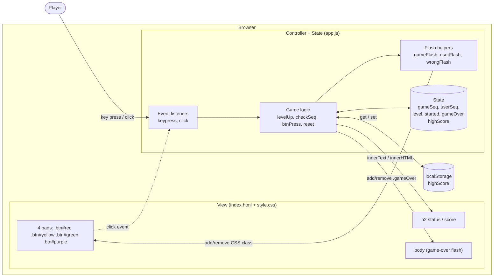
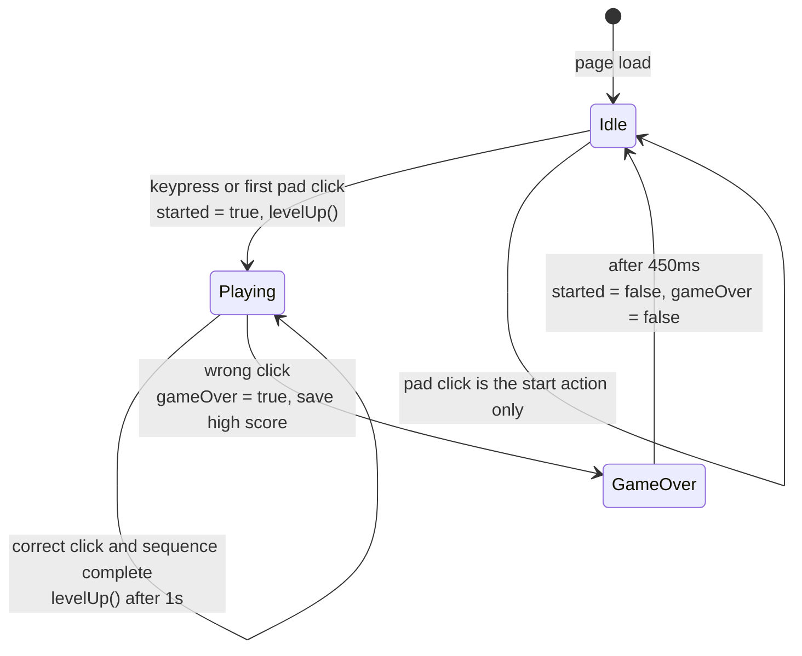
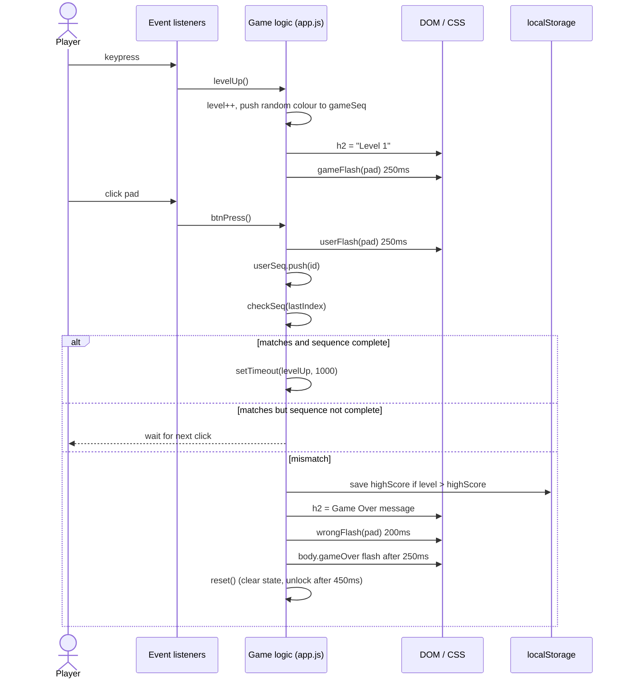

# Simon Says Game (v1)

A browser-based memory game built with plain HTML, CSS and vanilla JavaScript. The game adds one random colour to a sequence each level; the player has to repeat the sequence by clicking the coloured pads. One wrong click ends the game.

No frameworks, no build step, no dependencies. Just tap the link and play.

## Table of contents

- [How to play](#how-to-play)
- [Project structure](#project-structure)
- [Architecture](#architecture)
- [Game state machine](#game-state-machine)
- [Runtime flow](#runtime-flow)
- [State and data](#state-and-data)
- [Function reference](#function-reference)
- [Review notes](#review-notes)
- [Suggested improvements](#suggested-improvements)

## How to play

1. Open Attached Link.
2. Press any key (or click any pad) to start.
3. A pad flashes white. Click it.
4. Each level adds one more random colour. Repeat the whole sequence in order.
5. A wrong click ends the game, shows your score and the best score, and flashes the page red.
6. Press any key to play again.

The best score is stored in the browser's `localStorage` under the key `highScore`.

## Project structure

```
Guess-Game/
├── index.html
├── style.css
├── app.js
└── README.md
```

## Architecture

The app is a single-page, client-only application. JavaScript owns all state; the DOM is a thin view that is updated by adding and removing CSS classes and by writing into the `<h2>`.



Design characteristics:

- **Pattern:** simple MVC-like split. HTML/CSS is the view, `app.js` is controller and model combined.
- **State:** module-level globals (`let`) shared by every function.
- **Rendering:** imperative DOM updates; no virtual DOM or templating.
- **Timing:** `setTimeout` is used for flash durations, the delay before the next level, and the reset delay.
- **Persistence:** only the best score, via `localStorage`.

## Game state machine

State is held in two booleans, `started` and `gameOver`, which together form four states.



| `started` | `gameOver` | Meaning |
| --- | --- | --- |
| `false` | `false` | Idle, waiting to start |
| `true` | `false` | A game is in progress |
| `true` | `true` | Game just ended, inputs ignored (about 450 ms) |
| `false` | `true` | Not reachable in normal flow |

## Runtime flow

One full round, from the first key press to a correct answer and then a wrong one:



## State and data

| Variable | Type | Purpose |
| --- | --- | --- |
| `gameSeq` | `string[]` | The colours the game generated, in order. |
| `userSeq` | `string[]` | The colours the player clicked this level. Reset on every `levelUp()`. |
| `btns` | `string[]` | Colour names used for random selection: yellow, red, purple, green. |
| `level` | `number` | Current level; also used as the score. |
| `started` | `boolean` | A game is running. |
| `gameOver` | `boolean` | Blocks input while the game-over animation plays. |
| `highScore` | `string \| number` | Read from `localStorage` on load; updated on a new record. |
| `h2` | `Element` | Status and score line. |
| `allBtns` | `NodeList` | The four pads, used to attach click handlers. |

How answers are checked: after each click, `userSeq[i]` is compared with `gameSeq[i]` for the index just clicked. The comparison is incremental, so the game ends on the first mistake rather than at the end of the sequence.

## Function reference

| Function | What it does |
| --- | --- |
| `levelUp()` | Clears `userSeq`, increments `level`, updates the heading, picks a random colour, appends it to `gameSeq` and flashes it. |
| `checkSeq(lastIndex, btn)` | Compares the latest click with the expected colour. On a full correct sequence it schedules `levelUp` in 1 s. On a mismatch it updates the best score, shows the game-over message, flashes the pad and page, and calls `reset()`. |
| `btnPress()` | Click handler for every pad. Ignores input during game over, starts the game if idle, otherwise records the click and calls `checkSeq`. |
| `gameFlash(btn)` | White flash (250 ms) to show the game's colour. |
| `userFlash(btn)` | Green flash (250 ms) as click feedback. |
| `wrongFlash(btn)` | Red flash (200 ms) on the wrong pad. |
| `reset()` | Resets `level`, `gameSeq`, `userSeq`, then clears `started` and `gameOver` after 450 ms. |

## Review notes

Things a reviewer is likely to flag. Severity is a rough guide.

### Gameplay

| # | Severity | Issue | Where |
| --- | --- | --- | --- |
| 1 | High | **Only the newest colour is flashed.** The game never replays the earlier part of the sequence, so from level 2 the player has to remember everything from memory with no way to see it again. A real Simon replays the whole sequence each level. | `levelUp()` |
| 2 | High | **Input is not locked between levels.** After the last correct click there is a 1 s wait before `levelUp`. A click in that window pushes an extra item to `userSeq`; `userSeq[i]` is then compared with `gameSeq[i]` which is `undefined`, so the player is wrongly given game over. | `checkSeq()`, `btnPress()` |
| 3 | Medium | **Score is overstated by one.** `level` is incremented before the player answers, so failing on level 1 reports a score of 1 instead of 0. | `levelUp()`, `checkSeq()` |
| 4 | Medium | **Game-over lock is timing based.** `reset()` unlocks after a fixed 450 ms `setTimeout`, while the visual effects use 200/250 ms timers. These are independent timers, so they can drift apart if durations are changed. | `reset()` |

### Code quality

| # | Severity | Issue | Where |
| --- | --- | --- | --- |
| 5 | Medium | `keypress` is deprecated and does not fire for non-character keys such as Esc or arrows. Use `keydown`. | `app.js` top |
| 6 | Medium | Global mutable state shared by all functions. Fine at this size, but hard to test or extend. | `app.js` top |
| 7 | Low | Pads are looked up by class (`document.querySelector(\`.${randomClr}\`)`) in one place and by `id` elsewhere. Pick one. | `levelUp()`, `btnPress()` |
| 8 | Low | `highScore` comes back from `localStorage` as a string and is later compared with a number. It works through coercion, but should be parsed with `Number(...)`. | `app.js` line 7 |
| 9 | Low | Three nearly identical flash functions (`gameFlash`, `userFlash`, `wrongFlash`) could be one `flash(btn, className, ms)`. | flash helpers |
| 10 | Low | CSS class names mix styles (`gameflash` vs `userFlash` vs `wrongFlash`). Use one convention. | `style.css` |
| 11 | Low | Stray blank lines and inconsistent indentation inside some CSS rules. | `style.css` |

### HTML, CSS and accessibility

| # | Severity | Issue | Where |
| --- | --- | --- | --- |
| 12 | Medium | Pads are `div`s with `type="button"`. `type` is not valid on a `div`. They are not focusable and cannot be used with the keyboard. Use `<button>`. | `index.html` |
| 13 | Medium | Fixed 200 px pads plus 2 rem margins give a board wider than a phone screen, so the page overflows on mobile. | `style.css` |
| 14 | Medium | The only way to start on a touch device is to tap a pad, which is not obvious from the "Press any key" text. There is no Start button. | UX |
| 15 | Low | No `aria-live` on the status line, so screen readers are not told about level changes or game over. | `index.html` |
| 16 | Low | Colour is the only cue. No sound or shape differentiation, which is hard for colour-blind players. | UX |
| 17 | Low | Pad colours are pastel and the white "gameflash" is a small contrast change from some of them (for example the light blue pad). | `style.css` |

## License

Practice project; no license specified (but still goes to me :D).